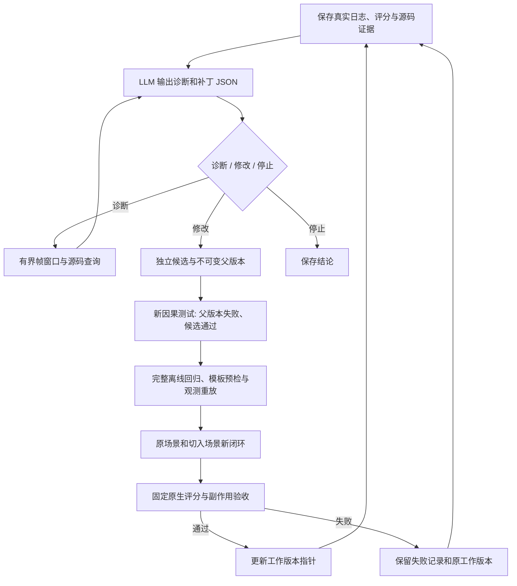

# 自主闭环补丁 Agent v1

把当前逐轮人工触发的工作接成可恢复的自动流程。真实模型接口和模型名称尚未填写；未调用真实模型，也未为本模块运行新的 GPU 实验。

默认起点是已完成配对闭环的 v17-r2：cutin551 HDScore 0.2628549161，original551 0.2763164887。它相对 v13 的目标增幅约0.0019484；严格 +0.01 矩阵尚未通过，172/552/621 仍缺注册资产。这里更新的是实验内的工作版本，不自动改生产默认驱动，也不宣称全场景无退化。



## 已实现的模块

| 文件 | 作用 |
|---|---|
| `provider.py` | 可替换的 Chat Completions 兼容 HTTP JSON 接口，配置缺失等待，区分认证/临时错误，保守计入未知请求预算 |
| `contracts.py`、`schemas/decision.schema.json` | 严格字段、证据摘要和引用校验，限定代码范围，保护物理安全、场景和评分代码 |
| `evidence.py` | 有界真实帧摘要、历史候选、源码上下文和注册诊断；历史失败与当前工作版本明确区分 |
| `builder.py` | 从已验证父版本生成独立代码、发布目录和验证框架；父版本和旧实验不覆盖 |
| `test_runner.py` | 验证因果测试确实在父版本断言失败、候选通过；所有历史测试保留，并核对实际导入实现 |
| `adapter.py`、`probe.py` | 接现有 HUGSIM 离线、SMPL、重放和两场景 GPU 验证；输出绑定真实编辑资产的编译指令 |
| `jobs.py` | 独立后台任务、PID/启动标识、日志和产出哈希、超时、取消、活任务接管，部分仿真换目录完整重跑 |
| `validation.py` | 与当前工作版本比较增幅，同时检查原场景、停止、碰撞、道路和相对 v13 的横向偏移 |
| `engine.py` | 多轮状态机、模型修正/诊断循环、轮数/时间/token/GPU预算、接受/拒绝/回退与完整记录 |
| `daemon.py`、`cli.py` | 后台启动、实时帧进度、停止/恢复、配置检查、汇总报告 |
| `presentation.py` | 对真实完整新旧闭环自动生成视频与路径速度图；视频失败不伪造评分失败或成功 |

## 后续只填写接口与模型

在 GPU 节点设置三个环境变量。密钥不写入配置、源码、命令参数或原生仿真子进程环境。

```bash
export PATCH_API_BASE_URL='https://apicz.boyuerichdata.com/v1'
export PATCH_MODEL='kimi-k3'
export PATCH_API_KEY='<your-api-key>'

D=${HUGSIM_ROOT}/integrations/autonomous-patch-agent-v1
bash "$D/run.sh" doctor --deep
bash "$D/run.sh" start
```

`start` 在后台启动协调器，终端断开后继续；重复执行不会启动第二个协调器。当前默认轮次 `patch_auto_v1` 将初始化为 `waiting_api`，API未配置时不发请求、不跑GPU、不消耗5小时运行计时。若换全新轮次，先执行 `init --campaign 新名称`。API接口若使用其他参数，可在新轮次初始化之前调整 `config.example.json` 的协议配置。

协议依据 [OpenAI 官方 Chat Completions 参考](https://developers.openai.com/api/reference/resources/chat/subresources/completions/methods/create)。默认使用 `json_object`，主机另外校验完整结构与证据；也保留 `json_schema` 和纯文本 JSON 选项。不能把模型返回合法JSON等同于诊断正确。

## 查询、停止与接管

```bash
bash "$D/run.sh" status
bash "$D/run.sh" stop
bash "$D/run.sh" resume       # 解除操作员STOP，前台接管
```

状态包含当前轮次、阶段、后台任务和两个闭环已推进的帧数。`stop` 写持久STOP，任务只取消自己的已登记进程组。HTTP请求可能等到超时返回后才响应停止。前台 `run` 被 Ctrl-C 退出时，已有后台阶段保留；`resume` 或重新 `start` 会接管它，不重复派发活任务。

仿真中断后不拼接模型历史、不复制旧动作。自动保留部分目录，用新的 attempt 从0完整重跑，最多2次基础设施尝试。预算耗尽或重复基础设施故障会停止并保留当前最佳版本；不会无限重试。修改冻结代码或预算需要创建新轮次，不能静默降低旧验收条件。

默认：最多3轮、18次模型请求、保守200万token、6次GPU配对尝试、5小时总运行时间；计时从API配置齐全的运行开始。每阶段CPU上限1800秒、GPU配对上限6000秒。超时或网络中断的模型请求按预留token保守计费，后续状态中的 `charged_tokens` 不冒充供应商账单。

## 固定验收

- 编辑场景 HDScore 相对当前工作版本严格提高；原场景 HDScore 不下降（仅浮点容差）。
- 两个场景各188控制步、189观测，完整新感知历史；无碰撞、地图越界、未解决停车，进度/停止指标符合既有阈值。
- 最终和峰值绝对横向偏移不得超过工作版本及 v13 中较小值加既有0.25m余量，避免多轮累计漂移；这是配对诊断门槛，非在线回正约束。
- 原生评分公式、场景编辑程序、测试和安全证书不能由模型修改；严格矩阵与缺失场景仍单独记录。

当前注册的自动代码修改范围仅为 `JointReference.retime_selected`、`retiming_cost`、`execution_benefit` 的函数体。感知网络、评分器、基础设施和其他类型补丁需要另外注册适配器，模型不能自行扩大范围。代码静态检查是工程完整性约束，不等价于操作系统沙箱；本工具用于受控的本地工程模型服务。

## 每轮记录

输出根目录：`outputs/.../chain_repair/phase26/autonomous_patch_agent_v1/campaigns/patch_auto_v1/`。

每轮保留 `evidence_*.json`、模型请求与脱敏响应、`failure_reason.json`、`edit_instruction.json`、`patch_instruction.json`、实际编辑资产的 `compiled_edit_instruction.json`、代码包清单、任务spec/日志/receipt、`acceptance.json` 和 `promotion.json`。总目录保存 `state.json`、事件日志、`working_champion.json` 与 `REPORT.md`。工作版本更新是原子指针更新，旧候选和失败产出保留。

## 验证与边界

`bash "$D/run.sh" selftest` 运行模拟模型/本地HTTP和状态机测试，不调用真实模型，不使用GPU。`smoke.py` 另接真实框架验证自动生成的版本直到GPU之前的全部门禁；它不构成模型提出的补丁，也不更新工作版本。

尚未验证真实供应商API与新外层协调器驱动GPU后的端到端联调；待接口和模型配置后执行。现有v17-r2两场景闭环已完成，但不作为新Agent已经完成新迭代的证据。
