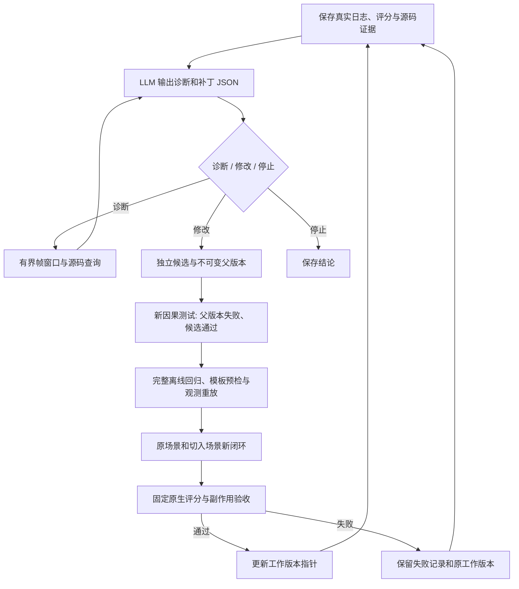

# v8：收敛后的强制泛化验收

本版在v7协调器基础上增加正式确认门禁。**工作版本不是正式补丁。** v7历史包、已执行结果和已用预算保持不变；v7命令不会自动变成v8，也未创建新预算或启动API/GPU。

状态顺序：本地迭代 → 连续3次合格增幅<0.01 → 冻结临时候选 → 自动逐场景泛化验证 → 全部不退化 → 保存正式补丁 → 才允许切换下一任务。

- 默认要求original172、original552、original621；至少两个不同held-out场景，不允许空集合或关闭真实运行的门禁。
- 每个场景单独比较相同输入的原生HDScore、PDMS、RC，只允许1e-9以内数值误差，不允许平均抵消退化。还要求完整闭环、无碰撞/越界/未恢复停车。
- 参考版本及场景、编辑、模型、地图、评分、物理配置均由主机冻结；每次候选必须重新闭环并拥有独立感知历史。增量基线与原始UniAD必须在任务中标明，不能混用。
- 缺准入或适配器：waiting_generalization_assets；基础设施或证据无效：generalization_failed；任一场景退化：rejected_generalization。以上均不产生正式确认文件，也不删除已有正式版本。
- 全部真实证据通过才写generalization/<ID>/accepted_patch.json及根目录accepted_patch.json原子指针，绑定补丁代码hash、基线、逐场景结果和收据。确认范围只限已注册场景，不代表所有可能场景。
- 候选、诊断和失败产出始终保留。task_archive是收敛候选归档，working_champion.json是临时工作指针，均不表示正式确认。
- 验证通过使用既有GPU/墙钟预算，不重新计数；恢复时观察同一作业，避免重复派发。泛化阶段不需要调用LLM/API。

当前三个held-out场景尚缺道路/语义/通用运行评分准入，因此流程会自动进入等待，不会伪装验证通过。目前**没有新正式确认补丁**。

## 操作与适配协议

沿用下方命令，但新入口为integrations/autonomous-patch-agent-v8/run.sh。不要用新建campaign绕过已耗尽的旧预算；未自动迁移旧campaign。

真实适配器增加两个主机方法：generalization_stage(case,candidate,folder,config)提供预检admission、command、inputs、outputs、timeout以及可选cwd；generalization_result(case,folder,job_receipt)返回结果证明的asset。命令不来自LLM。准入必须绑定case_id、candidate_pins和baseline，执行器使用同一jobs协议派发、持久化和恢复。

case.baseline是冻结JSON资产，包含code_pins、comparison_contract、episode（report/summary/contract资产）。结果证明含case_id、candidate_pins、baseline、comparison_contract及candidate的report/summary/contract。

comparison_contract冻结scene、scene_manifest、scenario、initial_context、source_end_frame、seed、model_weights、static_map、scorer、score_config、physics；文件项必须为可校验资产。每个执行contract绑定scene、code_pins、comparison_contract、fresh_history、score_kind=executed_path、独立history_run_id及controls。report绑定validation_contract与experiment_plan，声明真实闭环和冻结权重，保留started_epoch、trace及完整observations。plan必须绑定同一comparison_contract。原生分数从summary.native_scores.scores.executed_path读取，不能只提交passed=true或LLM文字。

测试中的generalization_fixture_bypass仅允许simulation_only的旧CPU模拟流程；模拟测试不能生成真实accepted_patch.json。

---

以下为继承的本地迭代操作说明；其中accepted/promotion仅指临时工作版本，正式保存以上述新门禁为准。

# 自主闭环补丁 Agent v7

把当前逐轮人工触发的工作接成可恢复的自动流程。真实模型接口和模型名称尚未填写；未调用真实模型，也未为本模块运行新的 GPU 实验。

稳定工作版本为 v17-r2，cutin551 HDScore 0.2628549161；最高分研究分支 v15-r2 为 0.2653346795，两者均保留。首轮从 v15 做最小副作用修复，并与 v15、v17 同时对照。原场景551分数均为0.2763164887。严格矩阵与缺失172/552/621仍独立记录，不能宣称全局有效。

新增 `governance.py` 强制执行 [迭代规约](ITERATION_POLICY.md)：维护候选集、限制基线选择、保护已有最高分、限制最小修改、要求实测后才可换路线。结果改善偏移却损失最高分时，保留为权衡候选，不提升稳定工作版本。`candidate_registry.json`、`base_selection_*.json` 和 `acceptance.json` 保留机器可审计依据。



## 已实现的模块

| 文件 | 作用 |
|---|---|
| `provider.py` | 可替换的 Chat Completions 兼容 HTTP JSON 接口，配置缺失等待，区分认证/临时错误，保守计入未知请求预算 |
| `contracts.py`、`schemas/decision.schema.json` | 严格字段、证据摘要和引用校验，限定代码范围，保护物理安全、场景和评分代码 |
| `evidence.py` | 有界真实帧摘要、历史候选、源码上下文和注册诊断；历史失败与当前工作版本明确区分 |
| `builder.py` | 从已验证父版本生成独立代码、发布目录和验证框架；父版本和旧实验不覆盖 |
| `test_runner.py` | 验证因果测试确实在父版本断言失败、候选通过；所有历史测试保留，并核对实际导入实现 |
| `adapter.py`、`probe.py` | 接现有 HUGSIM 离线、SMPL、重放和两场景 GPU 验证；输出绑定真实编辑资产的编译指令 |
| `jobs.py` | 独立后台任务、PID/启动标识、日志和产出哈希、超时、取消、活任务接管，部分仿真换目录完整重跑 |
| `validation.py` | 与当前工作版本比较增幅，同时检查原场景、停止、碰撞、道路和相对 v13 的横向偏移 |
| `engine.py` | 多轮状态机、模型修正/诊断循环、轮数/时间/token/GPU预算、接受/拒绝/回退与完整记录 |
| `daemon.py`、`cli.py` | 后台启动、实时帧进度、停止/恢复、配置检查、汇总报告 |
| `presentation.py` | 对真实完整新旧闭环自动生成视频与路径速度图；视频失败不伪造评分失败或成功 |

## 后续只填写接口与模型

在 GPU 节点设置三个环境变量。密钥不写入配置、源码、命令参数或原生仿真子进程环境。

```bash
export PATCH_API_BASE_URL='https://YOUR_PROVIDER/v1'
export PATCH_MODEL='YOUR_MODEL'
export PATCH_API_KEY='YOUR_API_KEY'

D=${HUGSIM_ROOT}/integrations/autonomous-patch-agent-v8
bash "$D/run.sh" doctor --deep
bash "$D/run.sh" start
```

`start` 在后台启动协调器，终端断开后继续；重复执行不会启动第二个协调器。当前默认轮次 `patch_auto_v8` 将初始化为 `waiting_api`，API未配置时不发请求、不跑GPU、不消耗5小时运行计时。若换全新轮次，先执行 `init --campaign 新名称`。API接口若使用其他参数，可在新轮次初始化之前调整 `config.example.json` 的协议配置。

协议依据 [OpenAI 官方 Chat Completions 参考](https://developers.openai.com/api/reference/resources/chat/subresources/completions/methods/create)。默认使用 `json_object`，主机另外校验完整结构与证据；也保留 `json_schema` 和纯文本 JSON 选项。不能把模型返回合法JSON等同于诊断正确。

## 查询、停止与接管

```bash
bash "$D/run.sh" status
bash "$D/run.sh" stop
bash "$D/run.sh" resume       # 解除操作员STOP，前台接管
```

状态包含当前轮次、阶段、后台任务和两个闭环已推进的帧数。`stop` 写持久STOP，任务只取消自己的已登记进程组。HTTP请求可能等到超时返回后才响应停止。前台 `run` 被 Ctrl-C 退出时，已有后台阶段保留；`resume` 或重新 `start` 会接管它，不重复派发活任务。

仿真中断后不拼接模型历史、不复制旧动作。自动保留部分目录，用新的 attempt 从0完整重跑，最多2次基础设施尝试。预算耗尽或重复基础设施故障会停止并保留当前最佳版本；不会无限重试。修改冻结代码或预算需要创建新轮次，不能静默降低旧验收条件。

默认：最多3轮、18次模型请求、保守200万token、6次GPU配对尝试、5小时总运行时间；计时从API配置齐全的运行开始。每阶段CPU上限1800秒、GPU配对上限6000秒。API采用流式接收，总上限1200秒，空闲上限180秒，最大输出32768 tokens。超时或网络中断的模型请求按预留token保守计费，后续状态中的 `charged_tokens` 不冒充供应商账单。

## 固定验收

- 编辑场景 HDScore 相对当前工作版本严格提高；原场景 HDScore 不下降（仅浮点容差）。
- 两个场景各188控制步、189观测，完整新感知历史；无碰撞、地图越界、未解决停车，进度/停止指标符合既有阈值。
- 最终和峰值绝对横向偏移不得超过工作版本及 v13 中较小值加既有0.25m余量，避免多轮累计漂移；这是配对诊断门槛，非在线回正约束。
- 原生评分公式、场景编辑程序、测试和安全证书不能由模型修改；严格矩阵与缺失场景仍单独记录。

修改范围由父版本的注册适配器决定：v15 只允许 `JointReference.rollout` 函数体，保留已有曲率生成和全局选择逻辑；v17 只允许三个重定时辅助方法，一次最多改其中一个。两条分支分别执行原有机制测试，并使用已验证的 v17-r2 SMPL 启动适配。模型不能自行扩大范围、修改测试或改评分。静态代码门禁不等价于操作系统沙箱，本工具面向受控的本地工程模型服务。

## 每轮记录

输出根目录：`outputs/.../chain_repair/phase26/autonomous_patch_agent_v8/campaigns/patch_auto_v8/`。

每轮保留 `evidence_*.json`、模型请求与脱敏响应、`failure_reason.json`、`edit_instruction.json`、`patch_instruction.json`、实际编辑资产的 `compiled_edit_instruction.json`、代码包清单、任务spec/日志/receipt、`acceptance.json` 和 `promotion.json`。总目录保存 `state.json`、事件日志、`working_champion.json` 与 `REPORT.md`。工作版本更新是原子指针更新，旧候选和失败产出保留。

## 验证与边界

`bash "$D/run.sh" selftest` 运行模拟模型/本地HTTP和状态机测试，不调用真实模型，不使用GPU。`smoke.py` 另接真实框架验证自动生成的版本直到GPU之前的全部门禁；它不构成模型提出的补丁，也不更新工作版本。

尚未验证真实供应商API与新外层协调器驱动GPU后的端到端联调；待接口和模型配置后执行。现有v17-r2两场景闭环已完成，但不作为新Agent已经完成新迭代的证据。

## v3 API传输修复

用户实测：原正式输入55051 tokens，222.05秒结束，输出8192 tokens全部耗尽，finish_reason=length且正文为空。此前180秒非流式超时无法正确区分长推理与连接故障。推理消耗是当前解释，具体字段由新版逐项计数验证。

v3沿用v2全部基线/收益/最小修复门禁，控制代码及原生评分不改。上下文上限80000字符，仅对采样帧降采样，源码、评分、基线登记及诊断入口保留。输出上限32768 tokens是本次工程配置，仍须接口接受且真实返回完整JSON才算恢复；不保证模型一定能在此上限完成。

流式持续记录事件数、推理字符数和正文字数，不保存推理正文。已收到的真实usage即使因length截断也结算，未知请求仍保守预留。连续两次连接失败停止；长度截断立即blocked_api_response，不能无限重复。预算仍为每轮次200万tokens，不是账户余额；旧v2历史预留不清零、不冒充已退款。

简洁查看：`bash "$D/run.sh" brief`；持续查看：`watch -n 5 bash "$D/run.sh" brief`。模型或传输阻断后需诊断，不应直接循环resume。

v2默认轮次保持STOP；v3新轮次独立注册，等待GPU节点现有环境变量。旧v2诊断的63243 tokens和小请求104 tokens为用户提供的供应商回执，不属于v3调用记录。未将旧超时预留量解释为实际费用。

## v4 Kimi K3推理强度适配

v3真实模型名kimi-k3，响应846.62秒、推理133685字符、正文1214字符，finish_reason=length；实际输入26605+输出32769=59374 tokens。流式与记账已生效，但输出仍被大量推理消耗。v4为注册模型kimi-k3显式设置reasoning_effort=low，不对其他模型发送此参数；不提高32768输出上限、不放松补丁门禁。参数进入调用元数据便于审计。

官方依据：https://www.kimi.ai/help/kimi-api/api-model-selection ：K3始终启用思考，支持low/high/max，默认max。第三方中转是否转发该参数及真实完整JSON结果仍须GPU节点验证；不能保证低推理强度必然提分。

旧v3默认轮次保留阻断与59374实际用量；v4独立轮次只修API模型适配，不生成或应用任何被截断的补丁。启动时沿用GPU终端三个API环境变量。

## v5 诊断与失败处理修复

修复v4真实失败：trace_window先前包含完整候选轨迹和深层证书，导致所有请求超出上下文；拒绝也扣成功诊断次数；缺字段反馈不精确；结束轮次时feedback重复合并触发异常。v5采用有界标量/候选摘要、明确采样索引和完整文件哈希，单帧可查询候选比较；重复度量改为明确证据引用。多请求共享上下文上限，保留完整源码与所有评分事实。

只对成功获取新证据扣诊断次数；拒绝仍受原模型调用总数限制。诊断缓存按查询和源文件哈希复用，进入下一轮按文件身份重连；源文件变动不会复用。达到成功诊断上限后明确要求patch或stop，不无限开新轮重复取数。仍严格拒绝数组包装、缺字段、未知证据引用及越界查询，返回具体错误。

所有有效diagnose/stop也自动保存failure_reason.json、edit_instruction.json和patch_instruction.json，标明decision类型，空操作不等于补丁已应用。每次状态更新生成固定LATEST.md，链接当前或最新结束轮次，不需要手工设置R。模型响应、诊断请求和失败原始记录仍保留。

75项测试通过，含此前6组真实v4取数请求、六次格式错误后的正常结束、跨轮缓存和最新页更新。v5首次启动预载这些已保存观测的压缩诊断，沿用v15优先、K3 low、原有CPU/GPU验证与验收。旧轮次与用量保留，v5新轮次预算独立记录；不伪造旧GPU结果，也不应用v4未通过协议的补丁。

恢复预检额外验证：预载10项旧轮次诊断后，上下文仍低于80000字符，完整源码保留。仅对低优先级初始采样帧明确标注省略，不删除评分事实或原文件。格式纠错请求携带上一份被拒绝草稿与具体错误，仍逐项校验完整协议。

## v6 版本身份、真实草稿预检与网络保护

版本目录来自已验证代码/发布/同场景合同。seed_v17_r2按相同代码路径和哈希映射到v17，v16登记为只读历史对照，不加入优化前沿，也不能作为修改父版本。每次请求的schema列出可用canonical IDs，拒绝时明确列出missing_required、unknown_ids、allowed_ids。仅归一化唯一对象数组和已验证名称，不改补丁代码/评分/证据；多对象数组仍拒绝。归一化有独立审计文件。

代码精确替换、语法、注册方法范围和最小改动在协议校验后立即预检；后续构建和真实回归仍重复独立验证。未授权_rollout_variant和语法不完整的旧草稿不放行。

同一HTTPS端点的HEAD连通检查在预留模型tokens前进行，不发送提示或密钥；HTTP405等仍可继续POST，DNS/TLS失败不增加模型调用量或预留。证书校验、代理规则和两次失败停止保留。不能保证第三方SSL服务不再中断；已经提交POST的未知请求仍保守计入。

真实因果测试暴露并修复了planning_guard启动路径缺口：test_runner现在与原注册回归一样调用configure，并重新置顶受测控制器路径、核对导入文件身份。此前旧fixture掩盖了这个依赖。

84项测试通过。实际构建v5旧草稿并执行：启动预检通过，父因果测试按断言失败；候选也在同一fixture进度差断言失败（9.09885677未超过9.87345262），不证明补丁有效，未跑GPU。保留此诊断用于下一轮，不修改模型测试使它通过。

默认v6预载v5观测诊断、旧失败历史和真实离线草稿失败，待GPU终端API。旧v5停止且用量保留，v6新预算独立记录。状态与分析照常自动保存，固定入口campaigns/patch_auto_v8/LATEST.md。

## v7 收敛后轮换任务

用户指定阈值：连续3次有效配对闭环的绝对HDScore增幅小于0.01即判经验收敛。此阈值不是相对百分比，也不改变现有本地补丁晋升阈值。比较上一最佳分数；每次完整验证且不退化的零增幅也可计入。达到/超过0.01重置；完整但退化/不安全的结果重置；API/协议/代码/测试/基础设施失败不产生收敛观测。同一轮幂等记账；同任务的场景、编辑、种子和执行合同必须一致。不同任务使用自己的新基线和窗口，不跨场景比较裸分。

收敛时立即保存task_archive/<任务>/summary.json，包括最佳控制器、候选池、参考指标与证据；next_task_request.json列出下一项、缺失准入和剩余预算。已登记且ready的任务由主机选择，通过哈希绑定的适配器和匹配基线激活。沿用已接受策略，检查实际场景合同与新基线控制器哈希；任务切换不清空API/tokens/GPU/总运行时间使用量。后续候选提升还须复测历史任务，通过带收据和代码绑定的非退化检查；无证据不晋升。

max_rounds从3调整为12容纳多任务；其他实际资源上限不变：18次模型请求、200万保守tokens、6次GPU尝试、5小时。预算不足先停止，不靠切换绕过。

当前只有scene551_cutin_v1已完整准入；scene551_next_edit和scene552_next_edit是明确不可运行的占位任务，缺新编辑/场景资产、匹配基线和适配器。实际收敛后将waiting_next_task，已有任务适配器/切换与恢复接口，不能宣称已自动生成或跑通新场景。登记ready任务后会自动轮换。TASK_ADAPTER.md说明接入协议。

固定LATEST.md和brief显示当前任务、小增幅计数和0.01阈值；convergence.json记录全部判定。功能在模拟模型/CPU任务上验证，尚无本项目真实收敛或GPU跨场景切换结果。

## Current user-selected default

The user explicitly selected v15-r2 as the global runtime default on2026-11-14. `config.example.json` now resolves that verified release through `phase26/global_patch.json`; v17 and earlier source records remain historical. New issues are searched on the inherited v15 policy, without v17 as a prerequisite. `new_tasks.sh` uses fixed-baseline discoveryv2; old discovery entry is retired. Existing tokens, round counters, GPU usage and wall start are preserved. Future candidate promotion still requires the registered generalization gate; selecting the existing default does not fabricate missing held-out measurements.
